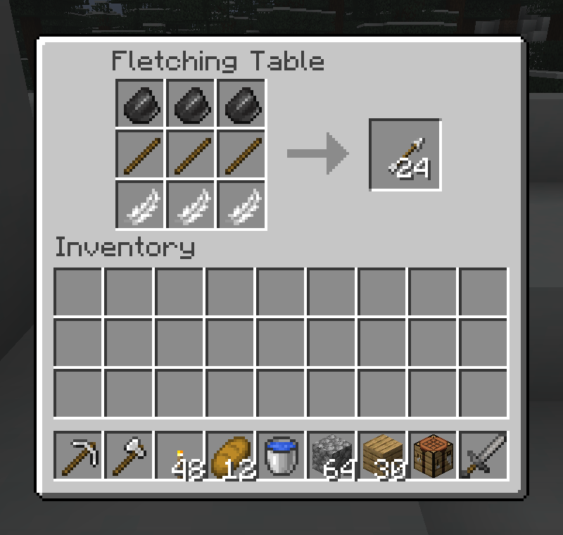

# Fletch Craft

A Fabric mod that makes the fletching table functional as a specialized crafting station for arrows, bows, crossbows, knapped flint and obsidian tools, and wood processing, with its own dedicated crafting bench.

## Features

- **Functional Fletching Table**: Right-click a fletching table to open a plain crafting bench - a 3x3 grid and a result slot, and nothing else on it
- **Visible to recipe books**: fletching recipes ship a shaped display, so a client can see what they are without this mod installed. They carry their own book category, which is what keeps them out of an ordinary workbench's book - they cannot be crafted there
- **Data-Driven Recipes**: All fletching recipes are JSON files under `data/fletch_craft/recipe/`, customizable via datapacks without touching code
- Included recipes:
  - **Arrows**: flint + stick + feather in a column makes 8, twice what a workbench would; three columns at once make 24
  - **Spectral Arrows** (3): glowstone dust + arrows
  - **Bow**: sticks + string
  - **Crossbow**: sticks + iron nugget + string (simplified recipe)
  - **Stripping**: place any log or bamboo block to get its stripped variant
  - **Sticks**: from stripped logs, planks, or bamboo
  - **Flint** (3): gravel
  - **String** (9): any wool color
  - **Target Block**: redstone + hay bale
  - **Flint and Obsidian Tools**: an axe, shovel and hoe in each, laid out like their vanilla shapes with flint or obsidian for the head. Flint digs like stone and obsidian like iron, both a little faster and a little less durable than the tier they borrow from. Obsidian enchants as well as gold. Repaired with their own stone
  - **Throwing Knives** (2): flint or obsidian over a stick. Right-click to throw; a knife drops where it lands, but one in five shatters on a hit. Obsidian hits harder
  - The tools and knives have no crafting table recipe at all: the fletching table is the only place they come from
- **Mirrored shapes**: every recipe also works flipped left to right, as at a crafting table

## Learning It

The fletching table has sat in fletchers' houses for years doing nothing, so nobody thinks to right-click one. And vanilla has no recipe for flint at all: you break gravel and hope.

With [village-quests](https://github.com/fatlard1993/village-quests) installed, a fletcher will tell you the trick and ask for twelve flint to prove it took. Four gravel in, three flint out, every time.

## Pandorical

Fletch Craft's entire fletching table interface is a Pandorical container screen, drawn on vanilla's own crafting table GUI texture at vanilla's own slot coordinates: the arrow, the result frame, the panel and every slot are the crafting table's, so the bench reads as one a player already knows how to use. The result slot is taken from directly, the way a crafting table's is.

Picking a recipe in a recipe book lays it out in the bench's grid, the same as a book does at a crafting table. Vanilla's own route for that (`ServerboundPlaceRecipePacket`) is answered only for a `RecipeBookMenu`, which a Pandorical menu is not, so the station fills its own grid through Pandorical's `onPlaceRecipe` hook: whatever is on the bench goes back to the player first, then one of each ingredient comes out of their pack. The mod checks for the `screens` capability when a player opens a fletching table and, without it, tells the player fletching requires Pandorical instead of opening anything.

The flint and obsidian items lean on Pandorical too: their textures are synced through Pandorical's content sync, and a knife in flight is drawn with its `thrown_item` renderer.

**The Pandorical mod must be installed on the server, and client-side to use the fletching table at all.** Vanilla clients (or clients without Pandorical) cannot interact with the fletching table through this mod.

## Customization

All recipes are data-driven JSON files in `data/fletch_craft/recipe/`. Server admins can add, remove, or modify fletching recipes via datapacks without touching code.

A fletching recipe is a `width`, a `height`, and its `ingredients` read row by row; `""` leaves a cell empty, as the axe and hoe do.

## Development

Installing is in [DEVELOPMENT.md](DEVELOPMENT.md).

## License

MIT, see [LICENSE](LICENSE).
